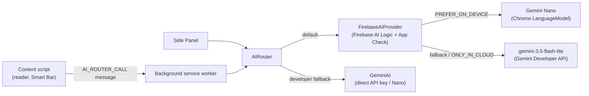

# 🎧 LearnFlow — Hands-Free Reader & Hybrid AI Companion (v1.5.2)

[](https://developer.chrome.com/docs/extensions/mv3/intro/)
[](https://firebase.google.com/docs/ai-logic/hybrid)
[](https://ai.google.dev/)
[](https://github.com/akmalkhaniub/learnflow-companion)
[](LICENSE)

> A Chrome extension that turns technical books, documentation and tutorials into a **continuous hands-free audiobook**. It explains code, tables and figures out loud as it reads, then moves to the next chapter by itself. Its AI runs through **Firebase AI Logic hybrid inference**: on-device Gemini Nano when the device supports it, with automatic cloud fallback, protected by Firebase App Check.

🎬 **Demo video:** _add link here_ · Built for **#BuildHybridAI 2026**

---

## 🧑‍⚖️ For judges: try it in 5 minutes

**1. Install (no build step needed)**

```bash
git clone https://github.com/akmalkhaniub/learnflow-companion.git
```

Open `chrome://extensions/`, turn on **Developer mode**, click **Load unpacked**, and select the cloned `learnflow-companion` folder. Pin **LearnFlow** to the toolbar. (Don't run `npm install` first. Chrome refuses to load a folder whose `node_modules/` contains `_`-prefixed files. The Firebase SDK bundle is already committed in `src/vendor/`.)

**2. Turn on the AI (30 seconds)**

The Firebase project config is pre-filled, so you only need an **App Check debug token**:

1. Copy the judge token from the **private submission notes**. It's not in this public repo.
2. Press `Alt+Shift+L` to open the Side Panel, then go to **Settings → ✨ AI Provider & Hybrid Configuration**.
3. Paste the token into **Firebase App Check Debug Token**, click **Save Firebase AI Settings**, then click **Test AI connection**.
4. You should see `AI connection works (Cloud · gemini-3.5-flash-lite)`, or `On-Device Nano` on a device that supports it.

**3. Demo path**

| Try this | What you'll see |
| :--- | :--- |
| Open any technical article with code blocks, click the LearnFlow toolbar icon, then press ▶ | Sentence-by-sentence highlighting. Each code block is read as one plain-English sentence (**Code Whisperer**). |
| Press `Alt+G` on the article | A spoken **2-minute audio brief** of the page |
| Look at the AI route badge in the Side Panel | `⚡ On-Device` or `☁️ Cloud`, plus latency, as reported by Firebase (`response.inferenceSource`) |
| Side Panel → **Study** → generate a quiz | Three multiple-choice questions about the current section |
| Type `lf what is this page about?` in the address bar | The Side Panel opens with the answer |
| Reach the end of an O'Reilly chapter or Google Skills step | LearnFlow clicks **Next** and keeps reading |

> **About Gemini Nano:** on-device inference only runs where Chrome's built-in AI is supported (roughly: a GPU with more than 4 GB of VRAM, or 16 GB+ of RAM with 4+ CPU cores, plus about 22 GB of free disk). See Chrome's [built-in AI requirements](https://developer.chrome.com/docs/ai/get-started). Settings shows Chrome's real status and offers a **⬇️ Download Gemini Nano** button when the model can be downloaded. Everywhere else, the same features run in the cloud automatically. `chrome://on-device-internals` shows what Chrome reports for your device.

---

## 🧠 How hybrid inference works



| Task | Inference mode | Why |
| :--- | :--- | :--- |
| Code Whisperer, table summaries, audio briefs, section quizzes, Anki cards, vault search | `PREFER_ON_DEVICE` (configurable) | Short text tasks run privately and offline on Nano when they can, and fall back to the cloud when they can't |
| Figure explanations (image + caption + nearby text) | `ONLY_IN_CLOUD` | Multimodal vision needs the cloud model |

- **One router, swappable providers.** `AIRouter` sends every AI call to the active provider. Firebase AI Logic is the default. Direct Gemini (your own API key) remains available as a developer fallback.
- **Works inside Manifest V3.** Content scripts can't run App Check, so they pass AI calls to the service worker. The worker loads the Firebase SDK with a static import, because service workers forbid dynamic `import()`. The worker has no DOM for reCAPTCHA, so App Check uses a DOM-free `CustomProvider` with debug tokens.
- **The badge shows the real route.** It reads `response.inferenceSource` from the SDK instead of guessing.
- **Configurable from Settings:** inference mode (Prefer On-Device / Cloud Only / On-Device Only) and cloud model.

---

## ✨ Features

**Hands-free reading**
- Native browser voices (offline, free) at 0.8×–2.2× speed, with highlighting that follows the current sentence
- Automatic **Next chapter** on O'Reilly Learning, **next lab step** on Google Skills (`skills.google`), and generic Next links or buttons. **Choose Next** lets you pick the control yourself.
- Works across same-origin iframes, Shadow DOM, callouts, and interactive lessons (accordions, tabs, flashcards, process slides)
- Read from here, previous/next section, and an optional **Follow my scroll** mode
- **Multi-tab playlist queue** that autoplays through queued pages, plus a sleep / Pomodoro timer (15, 25 or 45 minutes)

**AI companion**
- **Code Whisperer:** code blocks are spoken as one natural sentence instead of syntax
- **Figure and table explanations** while reading
- **2-minute audio brief** (`Alt+G`), **section quizzes**, **Anki flashcards** (CSV export), **vault search** over your saved notes
- Right-click: "✨ Ask Gemini to explain this snippet" or "🎧 Read aloud"

**Study and archive**
- **Home** with Resume, a chapter outline, and bookmarks with personal notes (stored only on this device)
- **Archive to Markdown:** tables become GitHub-flavoured Markdown, and figures are saved as separate images
- **YouTube study guides** with transcript timestamps and captured keyframes
- Optional **Google Drive sync** through your own Apps Script webhook

### ⌨️ Shortcuts

| Shortcut | Action |
| :--- | :--- |
| `lf <query>` in the address bar | Ask Gemini or search your vault |
| `Alt + L` | Play / pause |
| `Alt + G` | 2-minute audio brief |
| `Alt + Shift + L` | Toggle the Side Panel |

---

## ⚙️ Settings explained

| Setting | What it does |
| :--- | :--- |
| **AI Provider** | **Firebase AI Logic** (default, hybrid) or **Direct Gemini** (developer fallback with your own [AI Studio](https://aistudio.google.com) key) |
| **Firebase Web Config** | Pre-filled with the `learnflow-hybrid-ai` project. Firebase web config values are public identifiers, not secrets. You can paste your own project's config instead. |
| **App Check Debug Token** | Lets this browser pass App Check. Create one in Firebase Console → App Check → Apps → Manage debug tokens. |
| **Hybrid Inference Mode / Cloud Fallback Model** | Where text tasks run, and which cloud model is used (default `gemini-3.5-flash-lite`) |
| **📓 Obsidian & Local Storage** | The folder inside `Downloads/` where archived Markdown notes and images are saved (default `LearnFlow_Vault`). Point it at an Obsidian vault inside Downloads and notes appear in Obsidian automatically. Chrome only lets extensions save inside Downloads. |
| **☁️ Google Drive Sync** | Optional. In LearnFlow, click **📋 Copy Script**. In [script.google.com](https://script.google.com), create a project and paste it, then choose **Deploy → Web app** (*Execute as:* Me, *Who has access:* Anyone). Paste the `/exec` URL into LearnFlow. Anyone with that URL can upload to the folder, so keep it private. |

---

## 🛠️ Development

```bash
npm install                                             # esbuild + Firebase SDK
npm run build                                           # Rebuilds src/vendor/firebase-ai-bundle.js
powershell -ExecutionPolicy Bypass -File .\package.ps1  # Creates dist/unpacked/ and dist/learnflow-companion-v<version>.zip
node tests/regression.test.cjs                          # 22 regression tests (no dependencies)
python tests/e2e_test.py                                # 18 Playwright E2E tests (Microsoft Edge on Windows)
```

After `npm install`, load `dist/unpacked/` instead of the repo root. After changing code, reload the extension at `chrome://extensions/` and refresh open article tabs. The Side Panel header shows the loaded version.

**Project layout:** `src/content/` (extraction, reader, auto-navigation, Smart Bar) · `src/background/` (service worker, AI bridge, queue, downloads) · `src/sidepanel/` (Home, Study, History, Settings) · `src/utils/` (AI router and providers, Markdown builder, Drive sync) · `public/` (Firebase Hosting landing page)

---

## ⚠️ Known limitations

- **App Check debug tokens are for development and judging only.** A public release needs a production attestation provider. reCAPTCHA can't run on a `chrome-extension://` origin, so one option is a token page on Firebase Hosting or a custom backend provider.
- **Gemini Nano depends on the device** (see above). Unsupported devices always use the cloud model.
- The tests use local page fixtures and mocked AI responses. Signed-in O'Reilly pages are not covered by automated tests.

## 🔒 Privacy

Reading, text-to-speech and storage happen locally. AI features send the relevant page text to Gemini, on-device or through Firebase AI Logic. See [PRIVACY.md](PRIVACY.md) for exactly what is sent and when.

## 📄 License

MIT. See [LICENSE](LICENSE).
